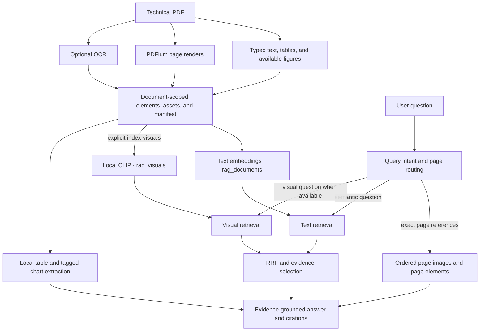

# PaperLens

PaperLens is a multimodal document intelligence system for exploring technical
PDFs. It keeps searchable text, page renders, extracted figures, spatial image
crops, and structured table/chart evidence connected to the original document
through stable IDs and page provenance. A Streamlit workspace provides the
human-facing workflows; ingestion, retrieval, extraction, and generation
continue to use the existing PaperLens CLI and modules.

## Multimodal system overview

PaperLens treats a PDF as both a text source and a visual source. During
ingestion, Unstructured provides typed text, tables, and available figure
elements. PDFium renders pages into stored image assets. Optional OCR adds text
and pixel-coordinate boxes for pages without extracted text. Large figures can
be split into deterministic overlapping crops; each crop remains linked to its
parent image and source page. These are spatial crops, not semantic image
captions or automatically detected chart regions.

Text and image retrieval use separate Qdrant collections and separate
representations. Text retrieval embeds element content in `rag_documents`.
Visual retrieval uses local CLIP embeddings in `rag_visuals`, and is created
only when `index-visuals` is explicitly run. Page renders are saved for
evidence, but enter visual indexing only with `--index-page-images` when no
figure was extracted. A query that benefits from visual evidence can combine
text and visual rankings with reciprocal rank fusion (RRF); missing visual
indexes fall back to text retrieval with a diagnostic. Explicit page questions
use the selected manifest's exact page render and preserve requested page
order rather than selecting pages through semantic search.

### What each modality contributes

- **Text and layout:** Typed parser elements and optional OCR are searchable in
  the text collection and retain document, page, element, and content-hash
  provenance.
- **Page images:** Full-page renders support direct page questions, visual
  comparison, and previews. Rendering alone does not imply image indexing.
- **Figures and crops:** Extracted images can be indexed with CLIP. Optional
  child crops keep parent IDs and pixel bounds so a retrieved region can be
  reviewed alongside its source figure.
- **Tables and charts:** Preserved HTML tables are parsed locally into
  structured rows. Numerical chart extraction is limited to explicitly tagged
  supported vertical bars/histograms with supplied geometry and axis metadata;
  digitized values are estimates and retain extraction status and provenance.
- **Answers:** The existing generator receives retrieved text and eligible
  image evidence. Citations are built from the evidence supplied for that
  answer. Numerical questions use structured evidence only when its status and
  coverage support the requested operation.

The architecture is deliberately evidence-oriented: the UI shows actual
manifests, assets, index state, answer citations, and extraction limitations.
An uploaded PDF is not treated as ingested until a manifest exists, and a
visual collection is not treated as ready until Qdrant confirms it. The
automated fixtures validate implementation behavior; they do not establish
answer quality on arbitrary real documents.

## Ingestion behavior

- **Text and headings:** Unstructured parses the PDF. Its `page` metadata is
  retained as a one-based page number.
- **Tables:** `text_as_html`, when supplied by Unstructured, is retained as
  `metadata.text_as_html` and used as the table's searchable content. HTML
  extraction is not guaranteed in Unstructured's `fast` strategy.
- **Figures:** When Poppler is available, Unstructured runs with `hi_res` and
  writes extracted figures into the document-scoped asset directory. Otherwise
  PaperLens uses `fast` for text extraction; full-page PDFium renders remain
  available as visual evidence.
- **Full pages:** Every page is rendered with `pypdfium2` at the configured
  scale. These images are saved as assets and linked from extracted elements
  and a document manifest; rendering by itself does not add pages to the vector
  index or call a vision model. Pass `--index-page-images` to index a page
  image only when that page has no extracted figure.
- **OCR:** Pass `--ocr` to OCR only pages without non-empty extracted text.
  OCR uses the Tesseract executable and records its text, page number, bounding
  box, and pixel coordinate convention. If Tesseract is unavailable, PaperLens
  reports that explicitly. OCR is not a requirement for ordinary text
  extraction.
- **Visual child chunks:** Pass `--chunk-visuals` to create deterministic,
  overlapping spatial crops for large image elements. The default tile size is
  1024 by 1024 pixels, overlap is 128 pixels, and splitting also occurs when
  either source dimension exceeds 1024 pixels. Child records and crop assets
  are stored in the document manifest and document-scoped asset directory;
  they are not added to Qdrant. The original image remains the indexed and
  retrieved parent. Page renders are eligible only when `--index-page-images`
  is also requested. These are spatial tiles, not semantic or query-aware
  chunks; they do not identify chart regions or label visual content.

### Metadata and assets

The existing `uuid` element key and legacy `metadata.page` field are preserved.
New elements also carry `metadata.element_id`, `document_id`, `source_file`,
`source_path`, `element_type`, and a SHA-256 `content_hash`. Unstructured
coordinates are retained unmodified in `metadata.coordinates`; a validated
`bbox` is additionally provided as `[left, top, right, bottom]` in that same
coordinate system, with `page_width`, `page_height`, and available coordinate
system attributes. When coordinates are absent, the page-render association
supplies pixel dimensions and top-left pixel coordinates; PDF point dimensions
are kept separately as `pdf_page_width` and `pdf_page_height`. No page number,
bounding box, coordinate origin, or unit is invented for Unstructured
coordinates when the parser does not supply it. OCR bounding boxes use
top-left origin and pixels.

Assets are kept under `DOC_STORE_PATH` (default `.\doc_store`) in
`assets\<document-key>\pages` and `assets\<document-key>\extracted`.
Extracted images are named by content hash within their document directory to
reuse identical assets. Image references stored under this root are relative
to it and resolved by PaperLens when used. The
`documents\<document-key>\manifest.json` file records the source path/hash and
page-render mapping. Raw element JSON files remain at the storage root, keyed
by their UUID, for compatibility with the existing retriever.

Generated document IDs are stable for the same source path and PDF contents.
Element and Qdrant point IDs are deterministic for repeated ingestion of the
same document identity. Re-ingestion overwrites corresponding raw element
files, page renders, and the manifest; it does not remove unrelated assets or
old Qdrant points created before deterministic point IDs were introduced.
Older Qdrant records are not automatically migrated or deleted. If a clean
re-index is required, back up data and manage the collection explicitly.
