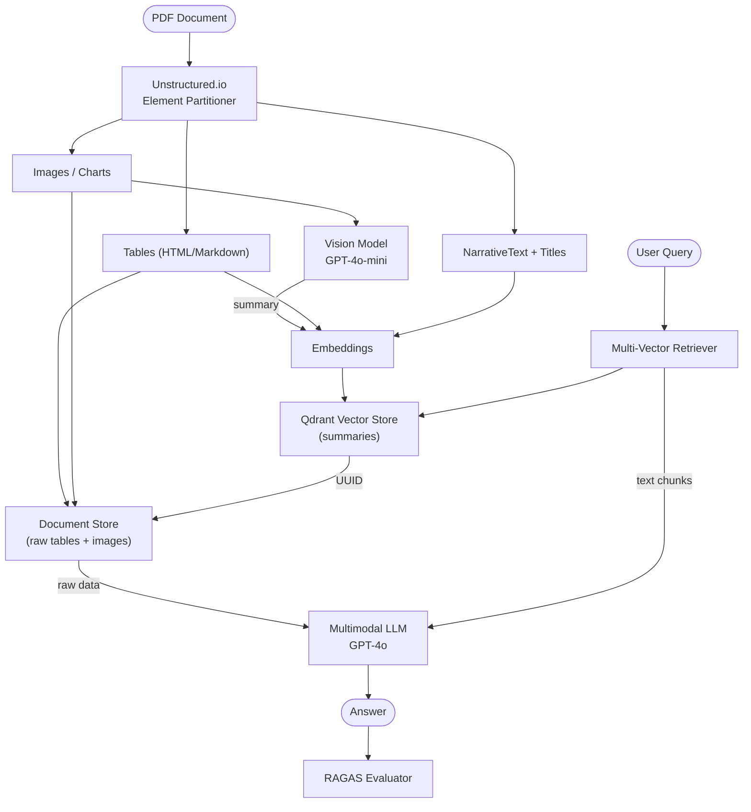

# Architecture

## System Diagram

## Module Responsibilities

| Module | File | Responsibility |
|---|---|---|
| Partitioner | `ingestion/partitioner.py` | PDF element extraction (Unstructured.io) |
| Table Converter | `ingestion/table_converter.py` | Table → HTML/Markdown |
| Image Summariser | `ingestion/image_summariser.py` | Vision model chart description |
| Embedder | `retrieval/embedder.py` | Embedding model wrapper |
| Vector Store | `retrieval/vector_store.py` | Qdrant index management |
| Document Store | `retrieval/document_store.py` | Raw element persistence (UUID-keyed) |
| Multi-Vector Retriever | `retrieval/multi_vector_retriever.py` | Summary search → raw data fetch |
| RAG Chain | `generation/rag_chain.py` | Multimodal prompt construction + LLM |
| RAGAS Evaluator | `evaluation/ragas_evaluator.py` | Faithfulness, Relevancy, Precision |
| Benchmark | `evaluation/benchmark.py` | Multimodal vs text-only comparison |
